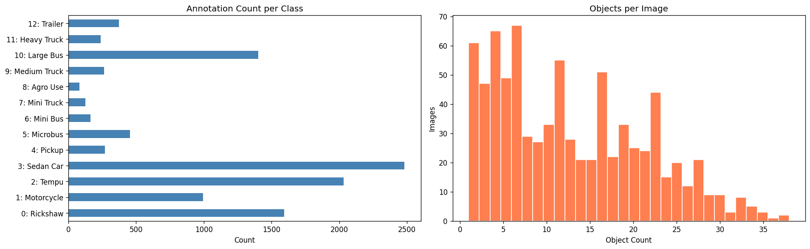
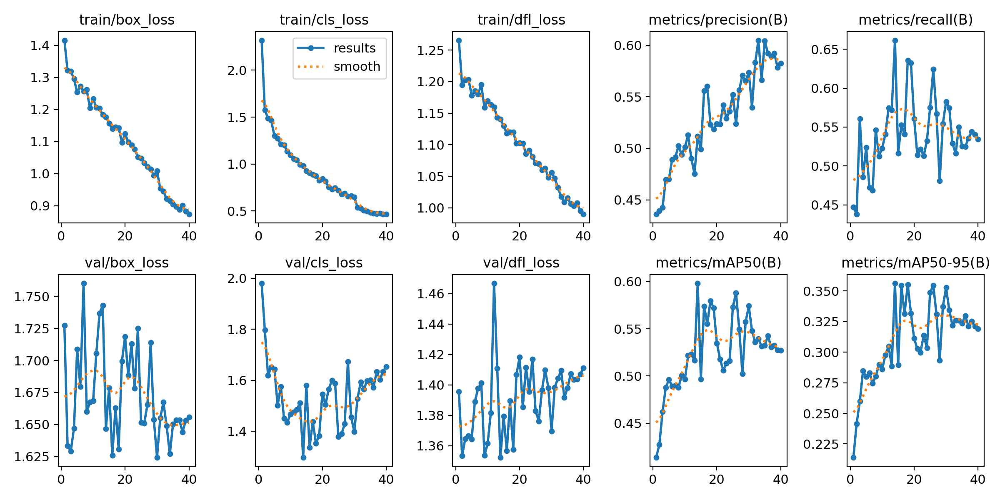
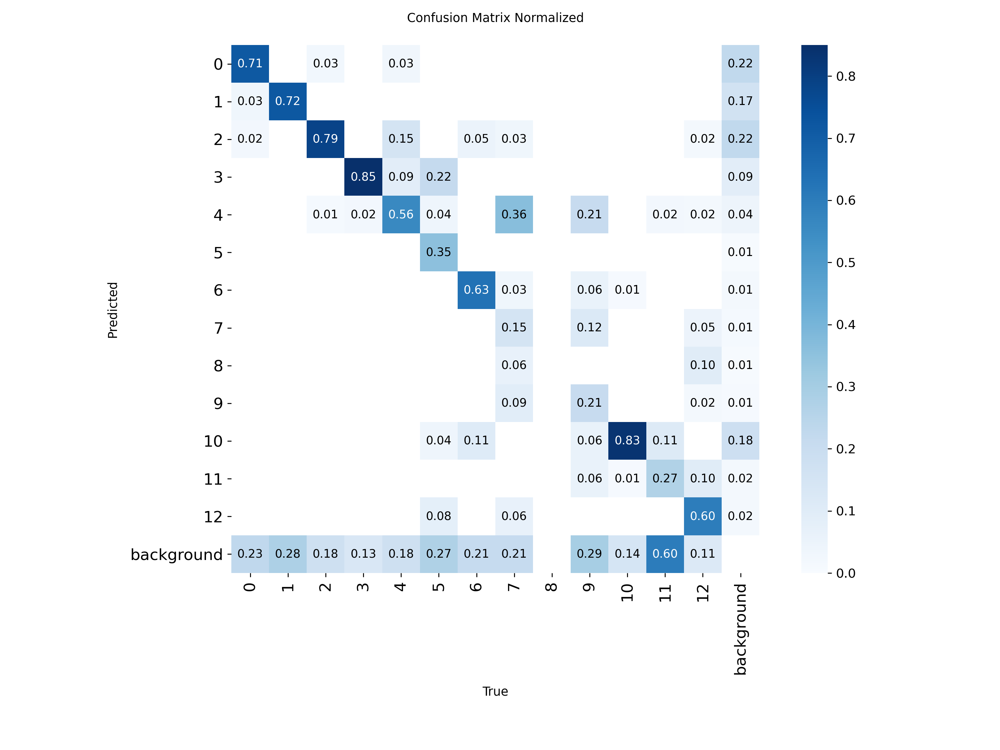
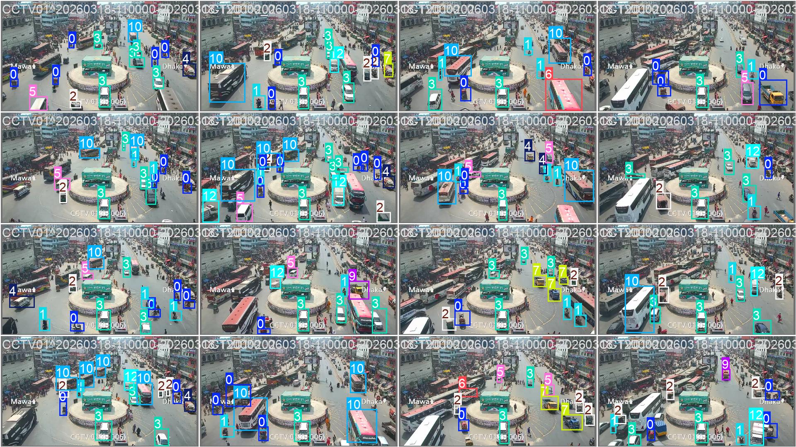
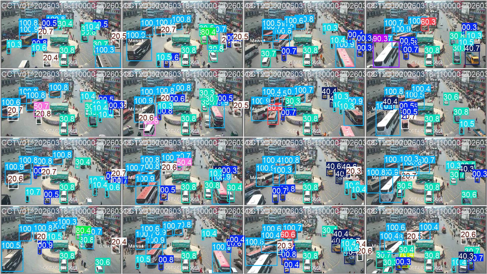
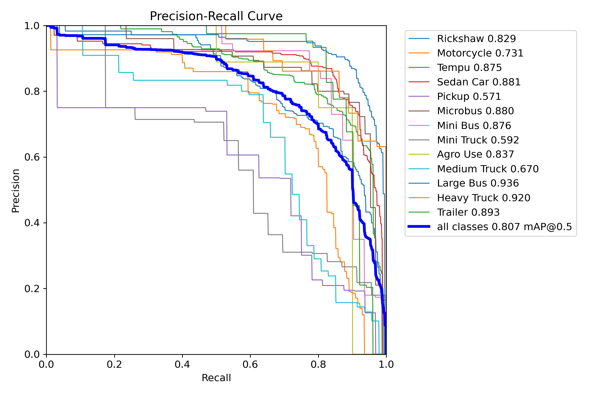
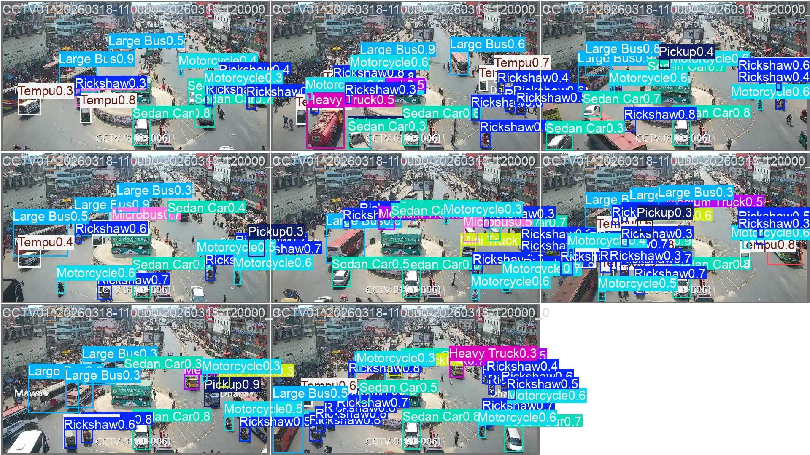

# RoadVision — Detecting Local Vehicles

**DUET AI Hackathon 2026 (Datathon)** — Vehicle detection and classification in Bangladesh's highway CCTV surveillance imagery.

---

## Overview

**RoadVision** tackles multi-class object detection on real-world Bangladeshi highway CCTV footage across **13 local vehicle categories** (including domain-specific vehicles absent from standard datasets like COCO/Cityscapes, such as CNG auto-rickshaws, rickshaws, easy-bikes, and legunas).

### Why This Problem Is Challenging
- **Tiny Labeled Dataset:** Only **810 annotated training images** (10,475 bounding boxes) and **327 test images**, all at `1280×720` resolution from **4 CCTV camera clips** (`CCTV01` daytime, `CCTV02` afternoon, `CCTV07` dawn, `CCTV10` evening).
- **Small & Distant Objects:** Most vehicles occupy less than 5% of the frame area, demanding native high-resolution (`1280px`) training and sliced inference.
- **Temporal Correlation:** Adjacent CCTV frames are near-duplicates — naïve random train/val splits cause severe data leakage and misleading local validation scores.
- **Domain Shift & Harsh Conditions:** Dense mixed-lane traffic, heavy occlusion, varying lighting (dawn/evening), and severe class imbalance.

<p align="center">
  
</p>

---

## Experiment Progression & Scoreboard

We improved Private LB performance by **+66%** (`0.3896 → 0.6454 mAP@0.5`) through systematic, hypothesis-driven iteration. Full experiment notes live in [`experiments/SCOREBOARD.csv`](experiments/SCOREBOARD.csv) and [`experiments/LOG.md`](experiments/LOG.md).

| # | Experiment / Notebook | Model | Resolution | Key Technique | Public LB | Private LB |
|:-:|:---|:---|:---:|:---|---:|---:|
| 1 | [`01_baseline_yolov8l_train.ipynb`](notebooks/kaggle_runs/01_baseline_yolov8l_train.ipynb) | YOLOv8-L | 960px | Random 80/20 split, `conf=0.25` (overfit baseline) | 0.38961 | 0.39760 |
| 2 | [`02_baseline_yolo11s.ipynb`](notebooks/kaggle_runs/02_baseline_yolo11s.ipynb) | YOLO11s | 960px | Leak-free temporal split, `conf=0.001` | 0.55276 | 0.55117 |
| 3 | [`03_tta_yolo11s.ipynb`](notebooks/kaggle_runs/03_tta_yolo11s.ipynb) | YOLO11s | 1280px* | Reused #2 weights + TTA (train/infer res mismatch) | 0.53314 | 0.56278 |
| 4 | [`06_rtdetr_baseline.ipynb`](notebooks/kaggle_runs/06_rtdetr_baseline.ipynb) | RT-DETR-L | 960px | Transformer baseline (NMS-free) | 0.52443 | — |
| 5 | [`07_rtdetr_hires_incomplete.ipynb`](notebooks/kaggle_runs/07_rtdetr_hires_incomplete.ipynb) | RT-DETR-L | 1280px | Transformer @ 1280px (stopped at epoch 49/70) | 0.47912 | 0.50688 |
| 6 | [`08_yolo11x_tta_high.ipynb`](notebooks/kaggle_runs/08_yolo11x_tta_high.ipynb) | YOLO11x | 1280px | High-res YOLO11x + TTA | 0.57428 | — |
| 7 | [`04_kfold5_yolov8s.ipynb`](notebooks/kaggle_runs/04_kfold5_yolov8s.ipynb) | YOLOv8s | 960px | 5-Fold per-clip temporal split + WBF | 0.56748 | 0.62783 |
| 8 | [`05_kfold5_yolov8s_iou05.ipynb`](notebooks/kaggle_runs/05_kfold5_yolov8s_iou05.ipynb) | YOLOv8s | 960px | Same #7 weights, `iou=0.5` | 0.56135 | 0.63206 |
| 9 | [`09_kfold3_yolo11m_1280px.ipynb`](notebooks/kaggle_runs/09_kfold3_yolo11m_1280px.ipynb) | YOLO11m | 1280px | 3-Fold native 1280px + `mixup=0.1` + TTA + WBF | 0.63809 | 0.62520 |
| 10 | [`11_ensemble_kfold3_and_5.ipynb`](notebooks/kaggle_runs/11_ensemble_kfold3_and_5.ipynb) | YOLO11m (8×) | 1280px | Equal-weight WBF merge of 3-Fold + 5-Fold | 0.62124 | 0.64323 |
| **11** | **[`10_kfold5_yolo11m_1280px.ipynb`](notebooks/kaggle_runs/10_kfold5_yolo11m_1280px.ipynb)** | **YOLO11m (5×)** | **1280px** | **5-Fold native 1280px + TTA + WBF** | **0.60328** | **0.64542** ★ |
| **12** | **[`12_hybrid_visdrone_sahi_wbf.ipynb`](notebooks/kaggle_runs/12_hybrid_visdrone_sahi_wbf.ipynb)** | **YOLO11 (3×)** | **1280px** | **VisDrone pretrain → 3-Fold + SAHI (512px) + TTA + WBF** | **0.64555** ★ | — |

---

## Best Solutions & Methodology

### 1. Best Private LB (`0.64542`): Native Hi-Res 5-Fold YOLO11m + TTA + WBF
- **Leak-Free Per-Clip Temporal K-Fold:** Each of the 4 CCTV clips is chronologically partitioned across 5 folds so every fold sees all camera angles/lighting conditions without frame-to-frame leakage.
- **Native `1280px` Training:** Training directly at `1280px` (matching the `1280×720` CCTV frames) calibrates spatial features for tiny/distant vehicles.
- **Regularization for Small Data:** `mixup=0.1`, `mosaic=1.0` with `close_mosaic=10` to fine-tune on clean frames in the final epochs.
- **Ultra-Low Confidence + WBF:** Predicting at `conf=0.001` with Test-Time Augmentation (TTA) and fusing all 5 fold models via **Weighted Boxes Fusion** (`iou=0.6`, `skip_box_thr=0.0001`) maximizes mAP ranking quality.

### 2. Best Public LB (`0.64555`): Hybrid VisDrone + SAHI + WBF Pipeline
- **Phase 1 — Domain Pretraining:** Pretrained on **VisDrone 2019** (aerial traffic imagery) to learn dense, small-vehicle priors before touching the 810 competition images.
- **Phase 2 — Fine-Tuning:** 3-fold fine-tuning at `1280px` (80 epochs, AdamW, backbone freezing, `copy_paste=0.3`, perspective augmentation).
- **Phase 3 — Multi-Scale Inference:** Combines full-frame TTA predictions with **SAHI** (`512×512` tiled inference with 30% overlap) to catch distant tiny vehicles, fused via WBF.

---

## Visual Results

### Training Curves & Confusion Matrix (5-Fold YOLO11m @ 1280px)
| Training Curves | Normalized Confusion Matrix |
|:---:|:---:|
|  |  |

### Validation Detections (Ground Truth vs. Predictions)
| Ground Truth Labels | 5-Fold YOLO11m Predictions (`0.6454` Priv) |
|:---:|:---:|
|  |  |

| Hybrid Pipeline Precision-Recall Curve | Hybrid Pipeline Predictions (`0.6456` Pub) |
|:---:|:---:|
|  |  |

---

## Key Lessons Learned

- **Temporal splits are non-negotiable for video/CCTV datasets** — random splits leak adjacent frames and hide overfitting.
- **Train at the resolution you infer at** — training at `960px` and inferring at `1280px` hurt Public LB; native `1280px` training unlocked our best scores.
- **K-Fold + WBF beats every single model** — averaging overlapping boxes across diverse folds consistently outperformed NMS and single-fold checkpoints.
- **Ultra-low confidence thresholds (`0.001`) matter for mAP** — mAP evaluates ranking across the full PR curve, not hard thresholded detections.
- **Public LB ≠ Private LB** — on small test sets (327 images), Public LB rankings shifted significantly on Private LB (5-Fold YOLO11m ranked lower on Public than 3-Fold, yet won Private LB).
- **CNNs beat Transformers at 810 images** — RT-DETR-L struggled with background confusion and small objects compared to YOLO11m's inductive bias.

---

## Repository Structure

```text
.
├── README.md                              # Project showcase & documentation
├── .gitignore                             # Excludes model weights (*.pt), archives, caches
├── data/                                  # Competition metadata CSVs
│   ├── train.csv
│   └── sample_submission.csv
├── experiments/                           # Complete experiment tracking & decision logs
│   ├── SCOREBOARD.csv
│   ├── SCOREBOARD.md
│   ├── LOG.md
│   └── submission_tracker.csv
├── notebooks/
│   ├── kaggle_runs/                       # Executed Kaggle notebooks (01 → 12, chronological)
│   ├── build/                             # Programmatic Python builders for standalone Kaggle notebooks
│   └── dist/                              # Generated self-contained Kaggle-ready .ipynb files
├── results/                               # Saved curves, confusion matrices, fold metrics & val plots
│   ├── hybrid_visdrone_sahi_wbf/
│   ├── kfold5_yolo11m_1280px/
│   └── rtdetr_baseline/
├── scripts/
│   └── validate_notebook.py               # Automated pre-upload sanity checker for Kaggle notebooks
└── presentation/                          # Final competition slide deck (27 interactive slides)
    ├── index.html                         # Open in any browser (arrow keys / fullscreen)
    ├── RoadVision_Presentation.pdf        # High-res exported PDF deck
    ├── export_pdf.py                      # Script to re-export HTML slides to PDF
    └── images/                            # Visual assets used in slides & README
```

> **Note on Model Weights:** Trained `.pt` checkpoints are excluded from Git via `.gitignore` to keep the repository lightweight. All notebooks are fully self-contained and reproducible on Kaggle GPU T4/P100 environments.

---

## Reproducing & Usage

### 1. Run Directly on Kaggle
Upload any self-contained notebook from [`notebooks/kaggle_runs/`](notebooks/kaggle_runs/) (or generated ones in [`notebooks/dist/`](notebooks/dist/)) to Kaggle with the RoadVision competition dataset attached and GPU enabled (`T4` / `P100`).

### 2. Regenerate & Validate Notebooks Locally
Our modular pipeline builds standalone `.ipynb` files from Python scripts so logic can be cleanly version-controlled:
```bash
# Regenerate a standalone Kaggle notebook (e.g., 5-Fold YOLO11m @ 1280px)
python3 notebooks/build/build_kfold5_yolo11m.py

# Validate generated notebooks before uploading to Kaggle
python3 scripts/validate_notebook.py notebooks/dist/roadvision_05_kfold5_yolo11m.ipynb
```

### 3. View the Presentation
- **Interactive Slides:** Open [`presentation/index.html`](presentation/index.html) in any modern browser (navigate with `←` / `→` or `Space`).
- **PDF Version:** Open [`presentation/RoadVision_Presentation.pdf`](presentation/RoadVision_Presentation.pdf).

---

## Team

- **Md. Tahmid Hossain**
- **Tahjib Hossain Khan**
- **Zahid Hasan Meherab**

*Built for **DUET AI Hackathon 2026** — RoadVision: Detecting Local Vehicles.*
